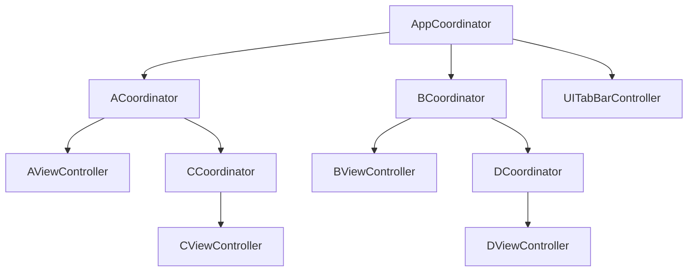

# Coordinator 패턴

화면 생성과 전환을 Coordinator에 모으는 방법을 학습한다. 이 프로젝트에서는 UIKit으로 화면 흐름을 관리하고, A·B 화면은 SwiftUI로 작성해 `UIHostingController`에 담는다.

## 1. Coordinator 패턴 기본 구조

Coordinator는 화면과 필요한 의존성을 생성하고, 다음 화면으로 이동하는 흐름을 관리한다. View나 ViewController에 흩어져 있던 화면 생성·push·present 코드를 분리하는 것이 핵심이다.

| 구성 요소 | 역할 |
| --- | --- |
| ViewController | 화면을 표시하고 사용자 입력에 따라 Coordinator에 전환 요청 |
| Coordinator | ViewController 생성과 화면 전환 실행 |
| 상위 Coordinator | 하위 흐름을 구성하고 필요한 동안 하위 Coordinator 보관 |

### 간단한 예시

ViewController는 다음 화면을 직접 만들지 않고 Coordinator에 전환을 요청한다. 아래 예제에서는 버튼 연결과 상세 화면 구현을 생략했다.

```swift
import UIKit

protocol Coordinator: AnyObject {
    func start()
}

final class HomeViewController: UIViewController {
    weak var coordinator: HomeCoordinator?

    @objc func didTapDetail() {
        coordinator?.openDetail()
    }
}

final class HomeCoordinator: Coordinator {
    private let navigationController: UINavigationController

    init(navigationController: UINavigationController) {
        self.navigationController = navigationController
    }

    func start() {
        let viewController = HomeViewController()
        viewController.coordinator = self
        navigationController.setViewControllers([viewController], animated: false)
    }

    func openDetail() {
        let viewController = UIViewController()
        viewController.title = "Detail"
        viewController.view.backgroundColor = .systemBackground
        navigationController.pushViewController(viewController, animated: true)
    }
}
```

상위 객체가 `HomeCoordinator`를 보관하고 `start()`를 호출한다. Coordinator → NavigationController → ViewController로 소유 관계가 이어지므로, ViewController의 Coordinator 참조는 `weak`으로 두어 순환 참조를 피한다.

### 간단한 의존성 그래프

상위 Coordinator가 하위 Coordinator를 관리하고, 각 Coordinator가 자신의 ViewController를 구성하는 개념도다. ACoordinator는 CCoordinator를, BCoordinator는 DCoordinator를 관리한다.



## 2. 내가 작업한 내용

### 최초 구현: CameraPickerCoordinator 분리

AppCoordinator에서 A·B 탭과 각각의 NavigationController를 구성했다. A·B Coordinator는 ViewModel과 SwiftUI View를 만들고, `UIHostingController`를 NavigationController에 등록한다.

카메라 흐름은 `CameraPickerCoordinator`로 분리했다.

- `UIImagePickerController` 생성과 카메라 표시
- 외부에서 받은 `allowsEditing` 적용
- delegate에서 편집 이미지 우선, 없으면 원본 이미지 추출
- picker를 닫은 뒤 completion으로 결과 전달
- 취소하거나 카메라를 사용할 수 없으면 `nil` 전달

A·B ViewModel은 Routing 프로토콜로 카메라 열기를 요청하고, 반환된 이미지를 화면 상태에 반영한다. 카메라 사용 목적은 `Info.plist`의 `NSCameraUsageDescription`에 작성했다.

처음에는 A·B Coordinator가 각각 카메라 Coordinator를 보관하고, 같은 `openCamera` 코드를 구현했다. 아래 코드는 최초 구현 당시의 completion 형태다.

```swift
private var cameraPickerCoordinator: CameraPickerCoordinator?

func openCamera(allowsEditing: Bool, completion: @escaping (UIImage?) -> Void) {
    guard cameraPickerCoordinator == nil,
          navigationController.presentedViewController == nil else { return }

    let coordinator = CameraPickerCoordinator(
        hostViewController: navigationController,
        allowsEditing: allowsEditing
    ) { [weak self] image in
        self?.cameraPickerCoordinator = nil
        completion(image)
    }
    cameraPickerCoordinator = coordinator
    coordinator.start()
}
```

카메라 화면 자체는 재사용했지만, **생성·보관·시작·해제 로직은 A·B에 중복**되어 있었다.

### 개선: 자식 관리와 공통 카메라 라우팅 추출

#### Coordinator 하나에서 역할별 프로토콜로 확장

최초에는 흐름을 시작하는 `start()`만 공통 `Coordinator` 프로토콜에 정의했다. A·B는 각각 카메라 Coordinator를 보관하고 관리했으며, `ARouting`과 `BRouting`에도 카메라 열기 요구사항을 따로 선언했다.

중복을 제거하면서 모든 기능을 `Coordinator`에 넣는 대신, 필요한 타입이 역할별 프로토콜을 조합하도록 변경했다.

| 프로토콜 | 담당 역할 | 적용 대상 |
| --- | --- | --- |
| `Coordinator` | 자신의 흐름 시작 | App, A, B, CameraPicker Coordinator |
| `CoordinatorContainer` | 자식 Coordinator 보관·시작·제거와 표시 호스트 제공 | App, A, B Coordinator |
| `CameraRoute` | 카메라 열기 요청과 조건부 공통 구현 | `ARouting`·`BRouting`을 통해 A, B Coordinator에 적용 |

```swift
// 최초: 자식 관리와 카메라 열기를 클래스마다 구현
final class ACoordinator: Coordinator, ARouting {
    // ...
}

// 개선: 필요한 역할을 조합해 공통 구현 사용
final class ACoordinator: Coordinator, CoordinatorContainer, ARouting {
    // ...
}

protocol ARouting: AnyObject, CameraRoute {}
```

`CoordinatorContainer`는 `Coordinator`를 상속하지 않는다. 흐름을 시작하는 능력과 다른 흐름을 관리하는 능력을 독립적으로 표현한다. 자식이 없는 CameraPickerCoordinator에는 컨테이너 요구사항을 추가할 필요가 없다.

`CameraRoute`도 카메라 열기 요청만 정의한다. `CoordinatorContainer`를 함께 채택한 경우에만 기본 구현을 제공하므로, ViewModel은 자식 배열이나 화면 표시 호스트를 알지 않고 기존 Routing 인터페이스로 요청할 수 있다.

#### CoordinatorContainer로 자식 관리 분리

처음에는 `ParentCoordinator: Coordinator`로 공통 자식 관리를 묶었다. 이후 “흐름을 시작하는 역할”과 “다른 Coordinator를 관리하는 역할”을 구분해, `Coordinator`를 상속하지 않는 `CoordinatorContainer`로 분리했다.

```swift
protocol CoordinatorContainer: AnyObject {
    var rootViewController: UIViewController { get }
    var childCoordinators: [any Coordinator] { get set }
}

extension CoordinatorContainer {
    func start(child: some Coordinator) {
        childCoordinators.append(child)
        child.start()
    }

    func end(child: some Coordinator) {
        childCoordinators.removeAll { $0 === child }
    }
}
```

App·A·B는 `Coordinator`와 `CoordinatorContainer`를 각각 채택한다. AppCoordinator는 탭바를, A·B는 각 NavigationController를 `rootViewController`로 제공한다. 화면 표시 호스트는 자식 관리와 별도의 역할로 추가 분리하지는 않았다. AppCoordinator도 `start(child:)`를 사용해 A·B를 보관하고 시작한다.

#### CameraRoute에 공통 구현 제공

화면별 Routing 프로토콜이 `CameraRoute`를 상속하도록 변경했다.

```swift
protocol CameraRoute {
    func openCamera(allowsEditing: Bool, completion: @escaping (UIImage?) -> Void)
}

protocol ARouting: AnyObject, CameraRoute {}
protocol BRouting: AnyObject, CameraRoute {}
```

`CoordinatorContainer`를 채택한 타입에 공통 구현을 제공한다. A·B의 개별 `openCamera` 구현과 `cameraPickerCoordinator` 프로퍼티는 제거했다.

```swift
extension CameraRoute where Self: CoordinatorContainer {
    func openCamera(allowsEditing: Bool, completion: @escaping (UIImage?) -> Void) {
        guard rootViewController.presentedViewController == nil else { return }

        let coordinator = CameraPickerCoordinator(
            hostViewController: rootViewController,
            allowsEditing: allowsEditing
        ) { [weak self] child, image in
            self?.end(child: child)
            completion(image)
        }
        start(child: coordinator)
    }
}
```

#### 완료된 자식 제거

공통 구현에서 정확히 종료된 객체를 제거할 수 있도록 CameraPickerCoordinator의 completion을 변경했다.

```swift
// 최초
(UIImage?) -> Void

// 개선
(CameraPickerCoordinator, UIImage?) -> Void
```

촬영 완료·취소·카메라 사용 불가 시 `completion(self, image)` 또는 `completion(self, nil)`을 호출한다. 공통 라우팅에서 해당 자식을 제거한 뒤 ViewModel에 결과를 전달한다. ViewModel이 받는 completion은 `(UIImage?) -> Void` 그대로다.

`start(child:)`는 자식을 먼저 보관하고 시작한다. 따라서 카메라 사용 불가로 완료가 즉시 호출되어도 배열에서 제거할 수 있다. 부모는 completion에서 약하게 참조하고, 해제 확인을 위해 CameraPickerCoordinator의 `deinit`에 로그를 추가했다.

#### 현재 선택과 남은 한계

- 다른 모달이 표시 중이면 추가 요청을 무시한다. 이 경우 completion은 호출하지 않는다.
- 자식 배열에 카메라 Coordinator가 있다는 이유만으로 요청을 차단하지 않는다. 종료 처리 누락으로 오래된 자식이 남아도 그것이 재시도를 막는 조건이 되지 않도록 했다.
- 이 검사는 모든 전환 타이밍의 중복 요청이나 표시 실패까지 보장하지 않는다. 정상 종료 외 경로에서 자식이 남는 문제를 자동으로 복구하지도 않는다.
- `childCoordinators { get set }`는 공통 구현을 가능하게 하지만 배열을 외부에서 수정할 수 있다는 캡슐화의 한계가 있다.
- 카메라 생성은 이미 공통 구현 한곳에 모였다. 현재는 대체 구현이나 복잡한 생성 요구가 없어 별도의 Router나 Factory를 추가하지 않았다.

### 관련 코드

- [Coordinator와 CoordinatorContainer](CoordinatorPattern/Coordinator/Coordinator.swift)
- [AppCoordinator](CoordinatorPattern/Coordinator/AppCoordinator.swift)
- [ACoordinator](CoordinatorPattern/Screen/A/ACoordinator.swift) · [AViewModel](CoordinatorPattern/Screen/A/AViewModel.swift) · [AView](CoordinatorPattern/Screen/A/AView.swift)
- [BCoordinator](CoordinatorPattern/Screen/B/BCoordinator.swift) · [BViewModel](CoordinatorPattern/Screen/B/BViewModel.swift) · [BView](CoordinatorPattern/Screen/B/BView.swift)
- [CameraPickerCoordinator와 CameraRoute](CoordinatorPattern/Screen/CameraPicker/CameraPickerCoordinator.swift)
