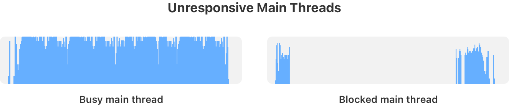
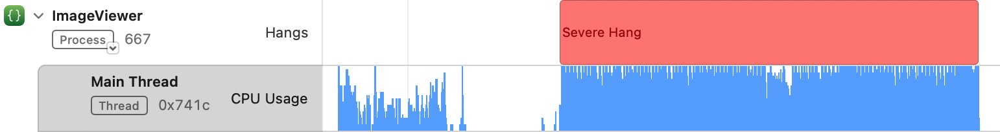
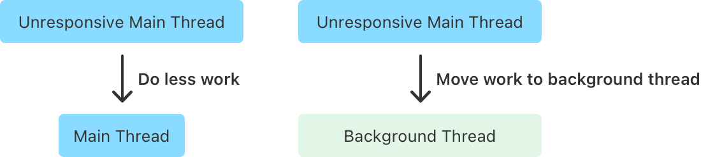
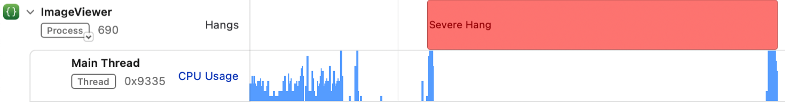

# Hang 분석 시작하기

- 원문: Apple, [Getting started with hang analysis](https://developer.apple.com/tutorials/instruments/getting-started-with-hang-analysis#Before-you-get-started)
- 열람일: 2026-10-19. 개인 저자·발행일·갱신일은 표시되지 않는다.
- 범위: Apple의 공개 문서 JSON으로 모든 본문 절을 대조한 한국어 요약이다. 전문 번역은 아니며, 주요 개념·분석 기준과 참고 자료를 정리했다. 예상 학습 시간은 10분이다.
- 이미지: 분석에 필요한 본문 이미지 4개를 `Assets/3-GettingStartedWithHangAnalysis/`에 저장했다. 라이트 모드 2배율 버전이다.

## 핵심 원리

Hang은 사용자 입력에 대한 반응이 눈에 띄게 지연되는 현상이다. 메인 스레드가 입력을 처리하므로, 그 스레드가 **계산 중인지, 대기 중인지**에 따라 조사 방향이 달라진다. 재현 → 기록·분석 → 수정 → 재측정을 반복한다.

## 시작 전 알아둘 것

SwiftUI 코드와 스레드·동시성의 기초, `Task`·`Actor`·`MainActor`·동시 실행 스레드 풀에 익숙해야 한다. 예제는 SwiftUI와 Swift Concurrency를 사용하지만 같은 성능 문제는 UIKit·AppKit·DispatchQueue에서도 발생한다.

사전 학습 링크: [Swift Concurrency](https://docs.swift.org/swift-book/documentation/the-swift-programming-language/concurrency/) · [Instruments 입문](https://developer.apple.com/videos/play/wwdc2019/411/).

## 입력 처리와 시간 기준

버튼을 누른 뒤 색이 바뀌는 것처럼, 입력과 화면 반응 사이의 지연이 사용자에게 드러나면 응답성이 나빠진다. 원문은 메인 스레드의 작업이 **중단 없이 100ms를 넘지 않도록** 권한다. 이는 프레임 시간이나 도구의 검출 임계값을 설명하는 문장이 아니다.

출처: [Hangs](https://developer.apple.com/tutorials/instruments/getting-started-with-hang-analysis#Hangs) · [Event handling and the main thread](https://developer.apple.com/tutorials/instruments/getting-started-with-hang-analysis#Event-handling-and-the-main-thread).

Hang은 화면을 직접 조작한다는 느낌을 깨뜨리고 앱이 정상 동작하는지 의심하게 만든다. 이벤트 처리와 렌더링 흐름에서 메인 스레드가 어떤 역할을 하는지 함께 이해해야 한다.

원문이 권하는 보충 자료:

- [Understanding user interface responsiveness](https://developer.apple.com/documentation/xcode/understanding-user-interface-responsiveness): 이벤트 처리와 렌더링 루프.
- [Understanding hangs in your app](https://developer.apple.com/documentation/xcode/understanding-hangs-in-your-app): 모든 사용자 입력 이벤트를 처리하는 메인 스레드와 Hang의 관계.

## 원인에 따른 분석

먼저 Hang을 재현한 뒤 해당 구간의 **메인 스레드** CPU 사용량을 확인한다. 입력 이벤트를 처리하지 못하는 상태가 무응답(unresponsive)이며, Busy와 Blocked를 구분해야 다음 조사 도구를 선택할 수 있다.

| 구분 | Busy: 계산으로 바쁨 | Blocked: 대기 때문에 멈춤 |
| --- | --- | --- |
| 메인 스레드 CPU 사용 | 높음 | 낮음 |
| 조사 대상 | CPU 시간을 많이 쓰는 함수 | 대기 시간·대상·대기 호출 코드 |
| 도구 | Time Profiler | Thread State Trace |
| 해결 방향 | 불필요한 작업 제거 또는 백그라운드 이동 | 동기 대기를 없애고 완료를 비동기로 통지 |

평균 CPU 사용량이 약 50%이거나 구간 내 변동이 큰 경우에는 지배적인 상태부터 조사한다. 대부분 낮고 잠깐 치솟으면 Blocked로, 판단이 어려우면 측정하기 쉬운 Busy부터 접근한다.

### Busy: 실행하는 작업 찾기

Time Profiler로 CPU 시간을 많이 쓰는 함수를 찾는다. 지금 필요하지 않은 작업을 줄이거나, 필요한 작업을 백그라운드로 옮긴 뒤 완료를 메인 스레드에 알리는 방식으로 개선한다.

어느 방향이 적절한지 판단하려면 함수의 실행 빈도도 살펴야 한다. Time Profiler만으로 개별 실행 정보를 알 수는 없으며, 그 이유와 측정 방법은 후속 튜토리얼에서 다룬다.

### Blocked: 기다리게 만드는 코드 찾기

다른 스레드·프로세스의 작업 완료나 잠금(lock) 해제를 기다리는 상태다. 운영체제는 그동안 다른 스레드에 CPU를 배정한다. 작업이 이미 백그라운드에 있다면 실제 작업을 바꾸지 않고도, 메인 스레드의 동기 대기를 제거하고 완료를 비동기로 통지하도록 바꿀 수 있다.

대기를 시작하는 코드는 CPU를 아주 잠깐 사용하고 실제 대기 중에는 CPU를 쓰지 않는다. 따라서 기본 Time Profiler로는 원인을 찾기 어렵다. Thread State Trace로 대기 시간, 기다리는 대상, 대기를 호출한 코드 위치를 조사한다.

출처: [분석 전략](https://developer.apple.com/tutorials/instruments/getting-started-with-hang-analysis#Hang-analysis-strategy) · [Busy](https://developer.apple.com/tutorials/instruments/getting-started-with-hang-analysis#Busy-main-thread) · [Blocked](https://developer.apple.com/tutorials/instruments/getting-started-with-hang-analysis#Blocked-main-thread).

## 다음 단계와 범위

다음은 [Identifying a hang](https://developer.apple.com/tutorials/instruments/identifying-a-hang) 실습이다. 후속 챕터는 Busy 사례를 다룬다. Blocked 분석은 원문이 안내하는 [Analyze hangs with Instruments](https://developer.apple.com/videos/play/wwdc2023/10248/)를 참고한다. 이 노트에서는 실습을 실행하지 않았다.

다음 실습에서는 Hang을 인지하고 Instruments로 기록한 뒤 Busy인지 Blocked인지 판별한다.

이미지 출처: [Apple — Getting started with hang analysis](https://developer.apple.com/tutorials/instruments/getting-started-with-hang-analysis). 이미지 저작권은 Apple에 있다.

[Instruments 로드맵으로 돌아가기](README.md)
