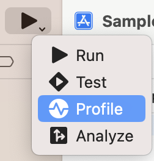
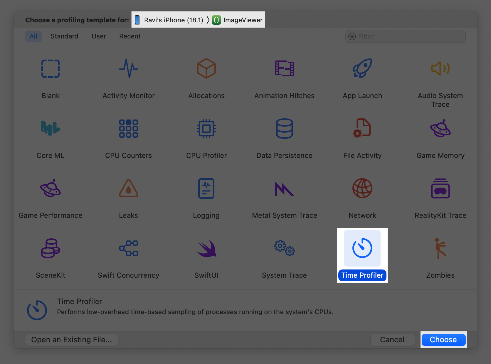
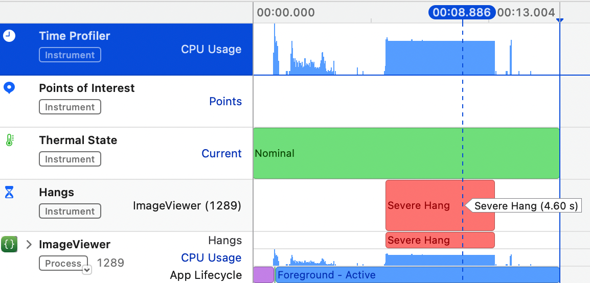
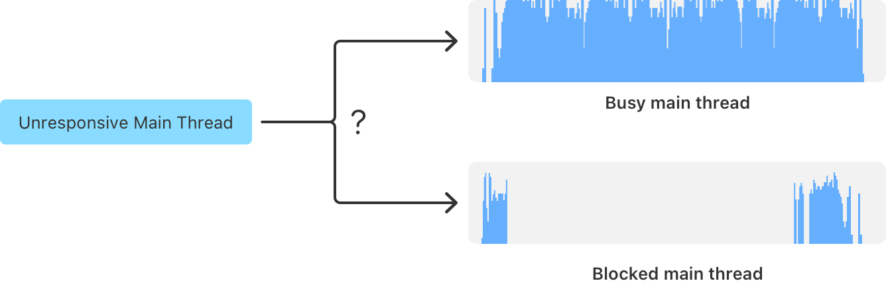

# Hang 식별하기

- 원문: Apple, [Identifying a hang](https://developer.apple.com/tutorials/instruments/identifying-a-hang)
- 열람일: 2026-11-22. 개인 저자·발행일·갱신일은 표시되지 않는다.
- 범위: Apple의 공개 문서 JSON 본문을 대조한 한국어 학습 노트와 로컬 코드 해설이다. 스터디 완료 상태를 반영했으며, 별도의 Instruments 재측정은 수행하지 않았다.
- 실습 코드: [4-IdentifyingAHang](Instruments-Sandbox/Instruments-Sandbox/4-IdentifyingAHang/)

## 핵심 원리

Hang이 발생한 **시간 구간과 메인 스레드**를 함께 좁혀서 CPU 사용량을 확인한다. 높으면 실행 중인 작업을, 낮으면 실행을 막는 대기를 조사한다. 이번 예제의 원문 측정 결과는 Busy main thread hang이다.

이 단계의 목표는 원인 함수를 확정하거나 코드를 최적화하는 것이 아니라, 재현 가능한 멈춤을 기록하고 다음 분석 방향을 정하는 것이다.

## 1. 멈춤 재현하기

앱을 실행하면 List 탭에 카테고리별 이미지 이름이 표시된다. 목록 스크롤, 이미지 선택, 뒤로 가기를 해 본 뒤 **Collection 탭을 처음 선택**한다. 화면 전환이 지연되고 그동안 다른 입력에도 반응하지 않는지 확인한다.

다시 List에서 Collection으로 이동하면 같은 멈춤이 재현되지 않을 수 있다. 원문 예제는 앱 실행 후 첫 전환에서만 발생하므로, 반복 확인할 때는 Xcode에서 앱을 다시 실행한다. 이 재현 조건을 놓치면 녹화에 문제 구간이 남지 않을 수 있다.

원문에서는 약 5초의 지연을 보여 준다. 이는 Apple 예제의 관찰값이며 로컬 실습의 측정값은 아니다. 기기와 시스템 상태에 따라 실제 시간은 달라진다.

출처: [Experience a hang](https://developer.apple.com/tutorials/instruments/identifying-a-hang#Experience-a-hang).

## 2. Profile로 기록하기

1. Xcode에서 실습 앱과 실행 기기를 선택한다.
2. **Product > Profile (`⌘I`)**을 실행한다. 기본 구성에서는 Release 빌드를 사용한다. Debug와 Release는 성능 특성이 다를 수 있으므로 비교할 때 빌드 조건을 맞춘다.
3. Instruments의 템플릿 선택 창에서 **Time Profiler**를 선택한다. 측정 대상이 자신의 기기와 앱인지 확인한다.
4. **Next Recording**에서 기록할 instrument와 옵션을 확인한다. 이 튜토리얼은 템플릿의 기본 구성을 사용한다.
5. Record를 눌러 앱을 새로 실행하고, List 화면을 조작한 뒤 Collection 탭으로 전환해 Hang을 재현한다.
6. 화면 전환이 끝나면 기록을 중지한다. **Hangs 트랙의 빨간 구간**에 포인터를 올려 시작 시점과 지속 시간을 확인한다.
7. 기록 문서를 저장하고 Run 이름에 재현 조건을 적어 둔다. 이후 수정 전후의 기록을 비교하는 기준이 된다.

Time Profiler 템플릿에는 여러 instrument가 함께 포함된다. **Time Profiler의 CPU 사용량 그래프**와 **Hangs의 지속 시간 구간**은 서로 다른 정보를 보여 준다. 빨간 구간을 발견했다는 사실만으로 어떤 함수가 원인인지 알 수는 없다.

출처: [Find a hang using Instruments](https://developer.apple.com/tutorials/instruments/identifying-a-hang#Find-a-hang-using-Instruments).







위 기록의 `4.6 s`는 Apple 원문 예제의 측정값이다.

## 3. Hang 구간의 메인 스레드로 좁히기

프로세스 전체의 CPU 사용량에는 여러 스레드의 활동이 합산된다. Hang을 분류하려면 입력을 처리하는 메인 스레드만 따로 봐야 한다.

1. 앱의 프로세스 트랙 옆 펼침 삼각형을 눌러 스레드별 하위 트랙을 연다. 로컬 프로젝트에서는 원문의 `ImageViewer` 대신 실습 앱 이름으로 표시된다.
2. **Severe Hang** 구간을 Control-click하고 **Set Inspection Range**를 선택한다. 분석 범위를 Hang의 시작부터 끝까지로 제한한다.
3. **Main Thread** 트랙을 선택한다. 시간 범위와 스레드 범위를 동시에 좁힌 상태가 된다.
4. 필요하면 **View > Zoom > Zoom to Inspection Range**로 확대한다. 그래프에 포인터를 올려 CPU 사용량을 확인한다.

| Hang 동안의 메인 스레드 | 해석 | 다음 조사 방향 |
| --- | --- | --- |
| CPU 사용량이 높음 | Busy: 작업을 실행하느라 입력을 처리하지 못함 | Time Profiler로 실행 중인 함수와 호출 경로 분석 |
| CPU 사용량이 낮음 | Blocked 가능성: 대기 때문에 실행하지 못함 | 대기 원인 조사. 도구 선택은 [이전 노트](3-GettingStartedWithHangAnalysis.md) 참고 |

스레드 하나의 CPU 사용량은 최대 100%로, 한 코어를 전부 사용하는 상태를 뜻한다. 프로세스는 여러 스레드를 병렬로 실행할 수 있어 100%를 넘을 수 있다. 따라서 프로세스 전체가 바쁘다는 사실만으로 메인 스레드가 Busy라고 결론 내리면 안 된다.

Apple의 예제 기록에서는 Hang 동안 메인 스레드 CPU 사용량이 매우 높다. 따라서 이 사례는 **Busy main thread hang**으로 분류하고, 다음 단계에서 메인 스레드가 수행하는 작업을 분석한다.

출처: [Determine whether the main thread is busy or blocked](https://developer.apple.com/tutorials/instruments/identifying-a-hang#Determine-whether-the-main-thread-is-busy-or-blocked).



## 4. 로컬 실습 코드와 연결하기

아래는 현재 코드에서 확인한 구조다. 실행 시간이나 호출 횟수를 측정한 결과와는 구분한다.

| 파일 | 역할과 확인할 지점 |
| --- | --- |
| [IdentifyingAHangView.swift](Instruments-Sandbox/Instruments-Sandbox/4-IdentifyingAHang/Views/IdentifyingAHangView.swift) | 이미지 목록을 불러온 뒤 List와 Collection 탭을 구성한다. 초기 선택은 List다. |
| [ImageCollection.swift](Instruments-Sandbox/Instruments-Sandbox/4-IdentifyingAHang/Model/ImageCollection.swift) | 번들의 `Images` 디렉터리에서 파일 URL을 읽어 카테고리별로 묶는다. |
| [ImageCollectionsView.swift](Instruments-Sandbox/Instruments-Sandbox/4-IdentifyingAHang/Views/ImageCollectionsView.swift) | 각 카테고리의 가로 `ScrollView` 안에 `HStack`과 `ForEach`로 썸네일 뷰를 배치한다. |
| [ThumbnailView.swift](Instruments-Sandbox/Instruments-Sandbox/4-IdentifyingAHang/Views/ThumbnailView.swift) | `body`가 참조하는 `imageView`에서 썸네일을 동기적으로 생성한다. `imageView`에는 `@MainActor`가 명시되어 있다. |
| [ImageFile.swift](Instruments-Sandbox/Instruments-Sandbox/4-IdentifyingAHang/Model/ImageFile.swift) | 파일에서 `UIImage`를 만들고 `preparingThumbnail(of:)`로 축소 이미지를 준비한다. |

썸네일 표시 과정의 호출 관계는 다음과 같다.

```text
ImageCollectionsView.body
  → HStack / ForEach
    → ThumbnailView.body
      → imageView (@MainActor)
        → ImageFile.makeThumbnail(displayScale:)
          → image: UIImage(contentsOfFile:)
          → UIImage.preparingThumbnail(of:)
```

`ThumbnailView`의 핵심 부분은 다음과 같다.

```swift
@MainActor
var imageView: Image {
    guard let thumbnail = imageFile.makeThumbnail(displayScale: displayScale) else {
        return Image(systemName: "x.square")
    }
    return Image(uiImage: thumbnail)
}
```

이 구조에서는 화면을 구성하는 경로에서 이미지 읽기와 썸네일 준비를 동기적으로 수행한다. 또한 가로 컨테이너가 `HStack`이므로 화면 밖의 이미지 뷰 구성까지 함께 조사할 필요가 있다. 메인 스레드 작업량을 의심할 근거는 있지만, **어느 함수가 얼마나 오래 실행되고 몇 번 호출되는지**는 후속 프로파일링으로 확인해야 한다.

초기 목록 로딩에 `.task`와 `async`를 사용한다는 사실만으로 썸네일 생성까지 백그라운드에서 실행된다고 볼 수 없다. 목록 로딩과 `@MainActor imageView`의 동기 썸네일 생성은 서로 다른 호출 경로다.

## 측정 환경과 해석 범위

- 원문 예제는 Xcode 16·iOS 18 이상을 대상으로 한다. 설치 버전에 따라 메뉴와 트랙 구성이 달라질 수 있다.
- 성능 측정은 실기기를 기준으로 한다. 원문은 이 특정 문제의 학습에 한해 실기기가 없으면 iPhone 시뮬레이터도 사용할 수 있다고 안내한다.
- 첫 전환 여부, 빌드 구성, 기기와 시스템 상태를 맞춰 비교한다. 이번 문서에는 로컬 `.trace` 기록이나 실제 CPU 수치를 첨부하지 않았다.
- `HStack` 변경이나 비동기 처리 도입은 이후 학습에서 다룬다. 현재 단계에서는 재현 조건과 Busy/Blocked 판별을 정리한다.

이미지 출처: [Apple — Identifying a hang](https://developer.apple.com/tutorials/instruments/identifying-a-hang). 원문의 라이트 모드 2배율 이미지 4개를 로컬에 저장했다. 이미지 저작권은 Apple에 있다.

## 다음 단계

[Analyzing main thread activity](https://developer.apple.com/tutorials/instruments/analyzing-main-thread-activity)에서 같은 Hang 구간의 Profile 뷰와 호출 경로를 읽고, CPU 시간을 많이 사용하는 함수를 찾는다.

[이전: Hang 분석 시작하기](3-GettingStartedWithHangAnalysis.md) · [Instruments 로드맵으로 돌아가기](README.md)
