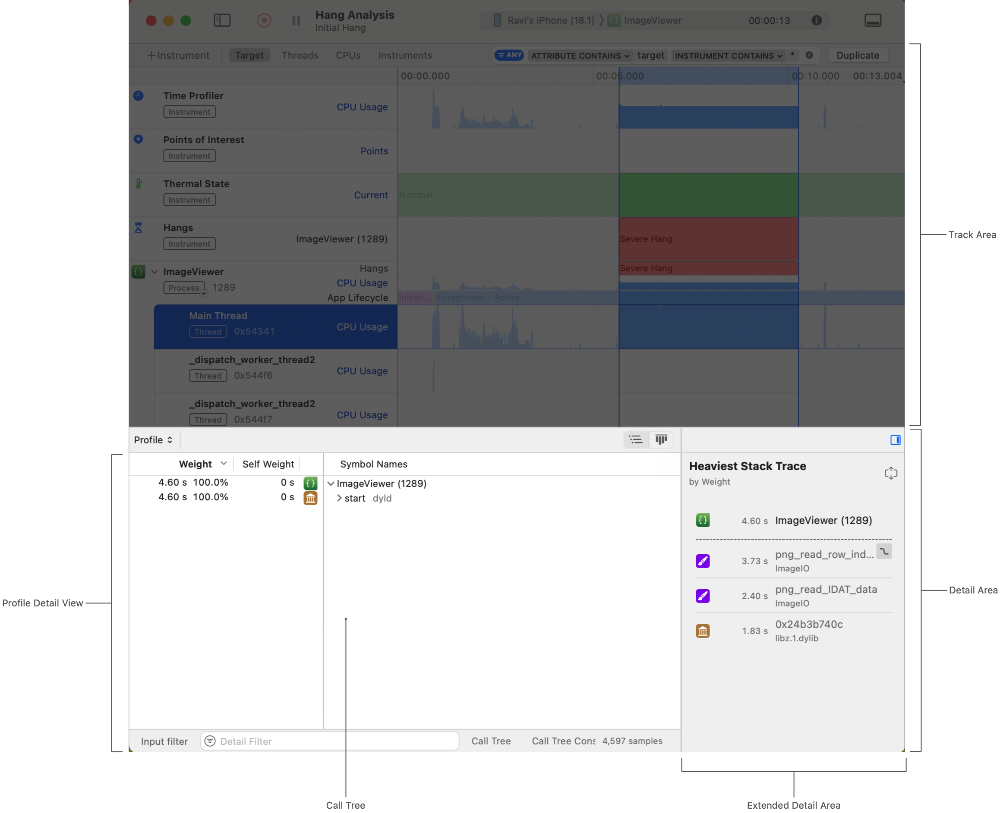
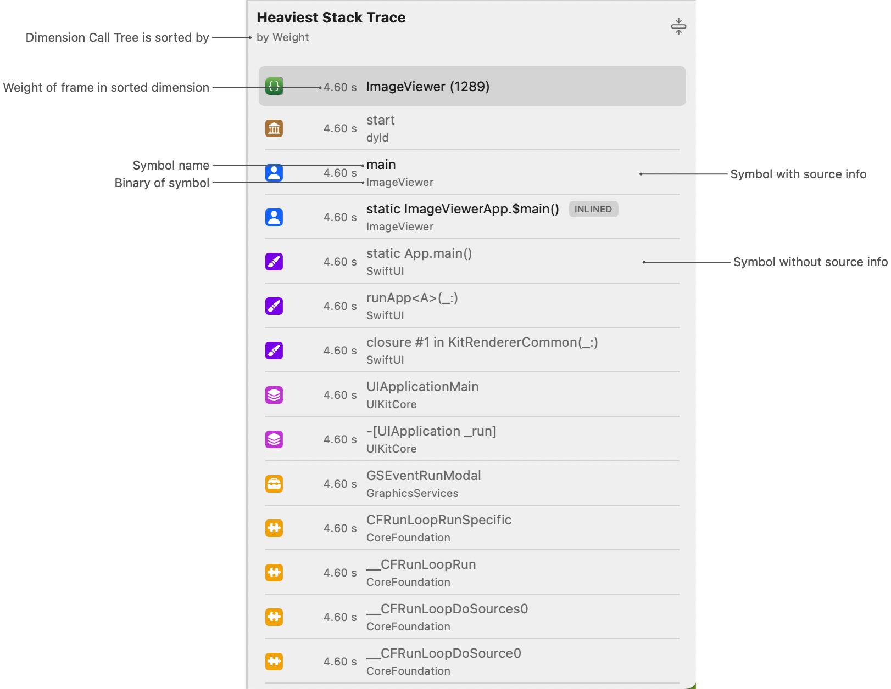
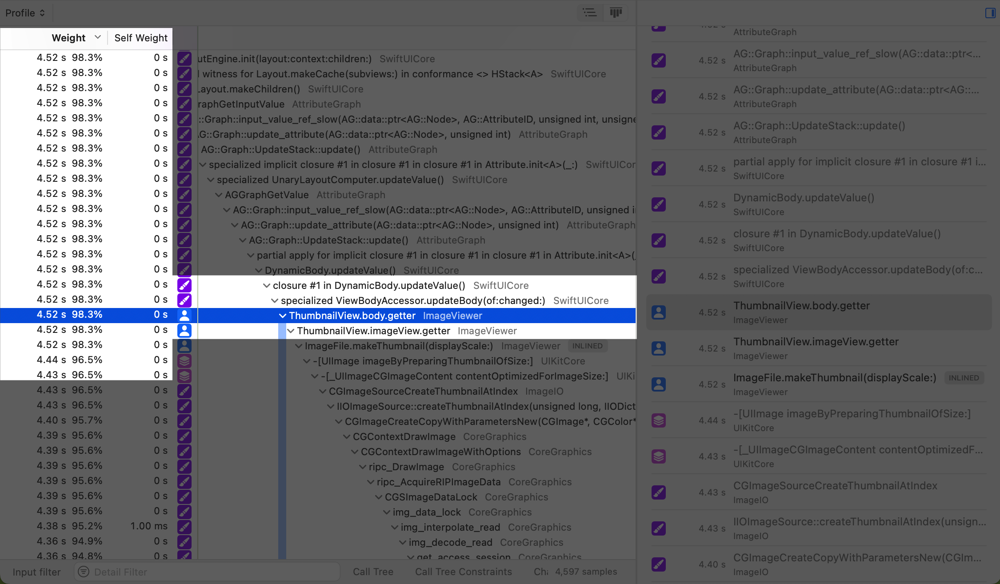

# 메인 스레드 활동 분석

- 원문: Apple, [Analyzing main thread activity](https://developer.apple.com/tutorials/instruments/analyzing-main-thread-activity)
- 열람일: 2026-11-22. 개인 저자·발행일·갱신일은 표시되지 않는다.
- 범위: Apple의 공개 문서 JSON 본문을 대조한 한국어 학습 노트다. 아래 측정 수치는 원문 예제의 값이며, 로컬 Instruments 재측정은 수행하지 않았다.
- 실습 코드: 앞 단계의 [4-IdentifyingAHang](Instruments-Sandbox/Instruments-Sandbox/4-IdentifyingAHang/)을 그대로 참고한다. 이 단계에서는 코드를 수정하지 않는다.

## 핵심 원리

[이전 단계](4-IdentifyingAHang.md)에서 메인 스레드가 Busy 상태임을 확인했다면, 이제 **Hang 동안 어떤 호출 경로에 CPU 시간이 집중되는지** 찾는다. Profile 뷰에서 시간 범위와 스레드를 제한하고, Heaviest Stack Trace를 따라 앱 코드까지 내려간다.

원문에서는 `ThumbnailView.body.getter`와 그 하위 호출에 약 4.5초가 집중되어 있다. 이는 조사할 코드 위치를 알려 주지만, 그 함수가 한 번 오래 실행된 것인지 여러 번 반복된 것인지까지 알려 주지는 않는다.

## 1. Profile 뷰의 범위 맞추기

이 튜토리얼은 이전 단계에서 기록한 Hang을 사용한다. 예제 환경은 Xcode 16·iOS 18이며, 설치된 버전에 따라 UI 배치가 다를 수 있다.

1. Instruments에서 이전 기록을 연다.
2. Hang 구간을 **Set Inspection Range**로 지정하고 **Main Thread** 트랙을 선택한다.
3. 창 아래 Detail Area에서 **Profile** 뷰를 확인한다. CPU 정보가 있는 트랙에서는 Time Profiler 템플릿이 기본적으로 이 뷰를 표시한다.



| 영역 | 읽는 정보 |
| --- | --- |
| Track Area | 시간에 따른 CPU 활동과 Hang 구간, 분석할 스레드 |
| Call Tree | 선택한 범위에서 샘플링된 함수의 호출 관계와 CPU 시간 |
| Heaviest Stack Trace | Call Tree를 요약한 하나의 무거운 호출 경로 |

시간 구간을 드래그하거나 다른 스레드를 선택하면 아래 데이터도 바뀐다. 분석 중 선택을 바꿨다면 **메인 스레드 + Hang 구간**으로 돌아온 뒤 수치를 해석한다. 앱 실행 전체나 다른 작업 스레드의 값이 섞이면 이번 멈춤과 관계없는 작업을 쫓을 수 있다.

출처: [Use the Profile view to understand main thread work](https://developer.apple.com/tutorials/instruments/analyzing-main-thread-activity#Use-the-Profile-view-to-understand-main-thread-work).

## 2. Call Tree 펼치기

Call Tree에서 `start` 옆의 삼각형을 눌러 하위 호출을 펼친다. 앱 진입점 부근에는 자식이 하나뿐인 프레임이 연속되기도 한다. **Option(⌥)-click**하면 자식이 여러 개로 갈라지는 지점까지 한 번에 펼칠 수 있다.

다만 호출 트리는 수천 개의 노드를 포함할 수 있다. 모든 프레임을 순서대로 읽기보다 오른쪽의 Heaviest Stack Trace로 중요한 경로를 먼저 찾고, 필요할 때 Call Tree로 돌아오는 편이 효율적이다.

## 3. Heaviest Stack Trace에서 앱 코드 찾기

Heaviest Stack Trace가 보이지 않으면 구분 막대의 오른쪽 끝 버튼으로 Extended Detail Area를 연다.

이 뷰는 루트에서 가장 큰 Weight를 가진 노드를 고르고, 그 아래에서도 가장 큰 자식을 반복해서 선택해 하나의 호출 경로를 만든다. Call Tree에 선택한 노드가 있다면 그 노드를 적어도 하나 포함하도록 경로가 제한된다. 따라서 현재 선택도 결과에 영향을 준다.



### 생략된 프레임 펼치기

기본 축약 상태는 CPU 시간 비중이 크게 달라지는 프레임 묶음을 중심으로 보여 준다. 이런 지점은 함수 자체의 작업량이 크거나 여러 하위 호출로 비용이 분산되는 곳일 수 있어 조사 출발점으로 유용하다. 계단 모양 아이콘도 이 지점을 표시한다.

그러나 축약 화면에서는 이미지 처리 관련 시스템 함수만 보이고 이를 호출한 앱 코드가 빠질 수 있다. 우측 상단의 전체 프레임 표시 버튼을 눌러 경로를 펼친다.

### 소스가 있는 프레임으로 이동하기

기본 글자색으로 표시되는 함수는 Instruments가 소스 정보를 알고 있는 함수다. 회색 프레임과 구분해 앱 바이너리의 함수를 찾는다. 기본 글자색 자체가 앱에서 직접 작성한 코드라는 보장은 없으므로 바이너리 이름도 함께 확인한다.

원문의 `ImageViewerApp.$main()`은 컴파일러가 생성한 진입점이다. 이를 찾는 데서 멈추지 말고 더 아래의 앱 코드를 찾는다. 소스 정보가 있는 프레임 위에 포인터를 올리면 파일과 줄 번호를 확인하고, 파일 이름을 클릭해 Xcode로 이동할 수 있다.

원문에서 찾는 주요 프레임은 **`ThumbnailView.body.getter`**다. 이 행을 선택하면 Call Tree도 해당 행으로 이동해 강조한다. 트리가 깊어 함수 이름이 가려졌다면 가로로 스크롤한다.

출처: [Identify relevant functions](https://developer.apple.com/tutorials/instruments/analyzing-main-thread-activity#Identify-relevant-functions).

## 4. Weight 해석하기



원문 화면에서는 `ThumbnailView.body.getter`의 Weight가 **4.52초, 98.3%**다. 선택한 메인 스레드와 Hang 시간 범위 안에서 이 getter와 하위 호출에 CPU 시간이 집중된다는 뜻이다. 약 4.6초의 전체 Hang을 거의 설명한다.

이 수치는 다음과 같이 읽어야 한다.

- `body` 자체뿐 아니라 **그 함수가 호출한 하위 함수의 시간도 포함**한다. getter의 몇 줄만 실행하는 데 4.52초가 들었다는 뜻은 아니다.
- 부모와 자식의 Weight에는 같은 샘플이 포함될 수 있다. 행마다 시간을 더하면 중복 계산하게 된다.
- 98.3%는 선택 범위의 CPU 시간 비중이다. CPU 사용률 그래프의 98.3%와 같은 지표로 읽지 않는다.
- 시간은 샘플링을 바탕으로 한 집계다. 한 번의 호출이 4.52초 걸렸다고 단정하거나, 이 값만으로 호출 횟수를 계산하지 않는다.

첫 문단의 수치와 결론은 Apple의 측정 결과다. 아래 해석은 해당 호출 트리를 읽을 때의 주의점이며 로컬 실습의 실측값을 추가한 것은 아니다.

## 5. 로컬 코드와 연결하기

[ThumbnailView.swift](Instruments-Sandbox/Instruments-Sandbox/4-IdentifyingAHang/Views/ThumbnailView.swift)의 `body`는 `imageView`를 읽고, `@MainActor`인 `imageView`는 동기적으로 썸네일을 생성한다.

```text
ThumbnailView.body
  → imageView (@MainActor)
    → ImageFile.makeThumbnail(displayScale:)
      → UIImage(contentsOfFile:)
      → UIImage.preparingThumbnail(of:)
```

[ImageFile.swift](Instruments-Sandbox/Instruments-Sandbox/4-IdentifyingAHang/Model/ImageFile.swift)의 이미지 읽기와 썸네일 준비가 getter 아래에 포함된다. 따라서 `body.getter`의 높은 Weight를 발견했다면 이 하위 작업까지 따라가야 한다. 위 경로는 소스에서 확인한 관계이며, 실제 스택의 프레임 표시나 비용 비중은 빌드와 측정 결과로 확인한다.

또한 [ImageCollectionsView.swift](Instruments-Sandbox/Instruments-Sandbox/4-IdentifyingAHang/Views/ImageCollectionsView.swift)는 가로 `HStack` 안에서 여러 `ThumbnailView`를 구성한다. 다음에는 개별 썸네일 작업의 비용과 전체 실행 빈도를 구분해 볼 필요가 있다.

## 결론과 다음 단계

이번 단계에서 확보한 것은 **CPU 시간이 집중된 앱 코드 위치와 호출 경로**다. 함수의 누적 비용이 크다는 사실만으로 근본 원인이나 수정 방법이 확정되지는 않는다.

다음 [실행 빈도 이해하기](6-DeterminingExecutionFrequency.md)에서는 한 번의 실행 비용과 실행 횟수를 구분하고 개선 방향을 판단한다. 다음 실습을 이어갈 때는 Instruments 문서를 열어 두고 기기 연결을 유지하면 설정을 재사용할 수 있다.

이미지 출처: [Apple — Analyzing main thread activity](https://developer.apple.com/tutorials/instruments/analyzing-main-thread-activity). 원문의 라이트 모드 2배율 이미지 3개를 로컬에 저장하고 표시 너비를 550~600px로 제한했다. 이미지 저작권은 Apple에 있다.

[이전: Hang 식별하기](4-IdentifyingAHang.md) · [Instruments 로드맵으로 돌아가기](README.md)
