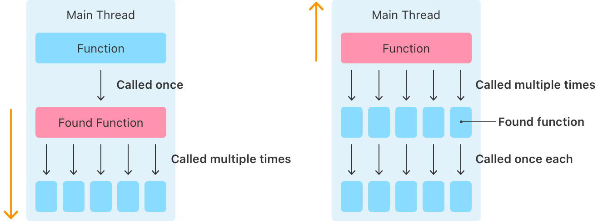
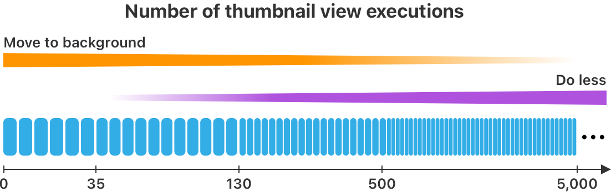
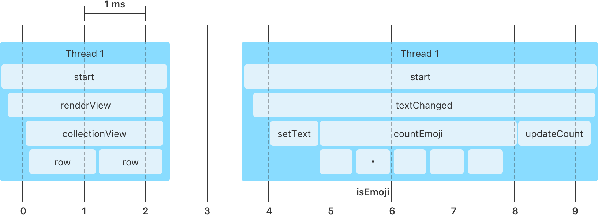
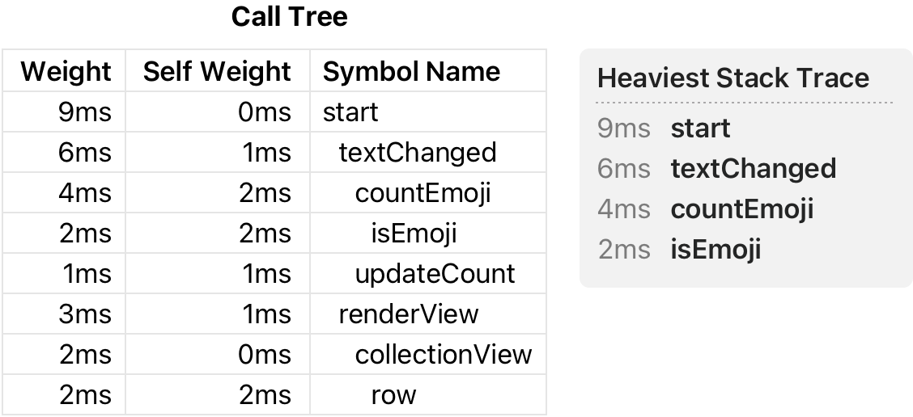

# 실행 빈도 이해하기

- 원문: Apple, [Determining execution frequency](https://developer.apple.com/tutorials/instruments/determining-execution-frequency)
- 열람일: 2026-11-24. 개인 저자·발행일·갱신일은 표시되지 않는다.
- 범위: Apple의 공개 문서 JSON 본문을 대조한 한국어 학습 노트다. 수치와 기기별 예시는 원문 기준이며, 로컬 호출 횟수나 실행 시간을 측정한 결과는 아니다.
- 실습 코드: [4-IdentifyingAHang](Instruments-Sandbox/Instruments-Sandbox/4-IdentifyingAHang/). 이번 내용은 분석 전략을 정하는 단계이며 코드는 수정하지 않는다.

## 핵심 원리

함수의 누적 CPU 시간이 크다고 해서 한 번의 실행이 느리다고 단정할 수는 없다. 짧은 작업이 너무 자주 실행된 결과일 수도 있다. **실행 횟수와 개별 실행 시간**을 알아야 호출을 줄일지, 내부 작업을 줄일지, 백그라운드로 옮길지 판단할 수 있다.

Time Profiler는 주기적으로 수집한 호출 스택을 집계한다. 누적 CPU 시간을 추정하는 데 유용하지만, 함수의 진입·종료를 기록하지 않으므로 호출 횟수와 개별 실행 시간은 별도 도구로 측정해야 한다.

## 1. 작업을 줄일지, 실행 위치를 바꿀지

Busy main thread hang에는 두 가지 기본 접근이 있다. 필요한 작업만 수행하도록 CPU 작업량을 줄이거나, 메인 스레드에서 할 필요 없는 작업을 백그라운드로 옮긴다. 두 방법을 함께 적용할 수도 있다.

### 작업량 줄이기

작업량을 줄이는 방법은 같은 결과를 더 적은 CPU 사이클로 계산하거나, 지금 필요하지 않은 계산을 생략하는 것이다. 원문은 저수준 최적화에 앞서 불필요한 항목을 처리하고 있지 않은지 확인하도록 권한다. 예를 들어 모든 메일 대신 최근 메일만 먼저 읽는 방식은 항목별 처리 속도를 조금 높이는 것보다 효과가 클 수 있다.

[이전 단계](5-AnalyzingMainThreadActivity.md)에서 찾은 `ThumbnailView.body.getter`에는 다음 두 조사 방향이 있다.

| 확인한 상황 | 조사할 방향 | 질문 |
| --- | --- | --- |
| 호출이 너무 많음 | 호출자(caller), 호출 스택의 위쪽 | 지금 이 호출이 모두 필요한가? |
| 호출은 필요하지만 내부 비용이 큼 | 피호출자(callee), 호출 스택의 아래쪽 | 내부에 생략하거나 줄일 작업이 있는가? |



출처: [Do less work](https://developer.apple.com/tutorials/instruments/determining-execution-frequency#Do-less-work) · [Decide whether to look up or down the call stack](https://developer.apple.com/tutorials/instruments/determining-execution-frequency#Decide-whether-to-look-up-or-down-the-call-stack).

### 백그라운드로 옮기기

UI를 직접 변경하는 작업은 메인 스레드에서 수행해야 하지만, 그 결과를 계산하는 작업까지 모두 메인 스레드에 둘 필요는 없다. 원문의 예시는 문서의 이모지 개수를 백그라운드에서 세고, 계산 결과를 화면에 표시하는 부분만 메인 스레드에서 수행한다.

다만 실행 위치를 바꾸는 데도 비용이 든다. 새 `Task` 생성뿐 아니라 기존 Task가 중단·재개되며 실행 위치를 바꾸는 데도 비용이 있다. 문자 하나마다 Task를 만드는 식으로 잘게 나누면 실제 계산보다 예약 비용이 커질 수 있다.

원문은 **1ms 미만의 작은 작업을 각각 dispatch하거나 비동기로 넘기지 않는 것**을 일반적인 기준으로 제시한다. 작은 작업이 많이 쌓여 Hang을 만든다면 여러 항목을 묶어 한 번에 넘기는 배치 처리를 고려한다. 이 값은 기기와 작업 특성을 무시하는 절대 경계가 아니라, 이동 비용과 실제 계산 시간을 비교하기 위한 원문의 실용적 기준이다.

`async` 표기만으로 실행 위치를 판정하지 않는다. 실제 적용에서는 함수의 actor 격리와 실행 환경을 확인하고, UI 반영과 계산을 구분해 측정해야 한다. 이 노트에서는 원문의 동시성 코드 예제를 그대로 이식하지 않고 작업 단위와 비용 판단에 집중한다.

출처: [Move work to a background thread](https://developer.apple.com/tutorials/instruments/determining-execution-frequency#Move-work-to-a-background-thread) · [Avoid too much overhead of executing work in the background](https://developer.apple.com/tutorials/instruments/determining-execution-frequency#Avoid-too-much-overhead-of-executing-work-in-the-background).

## 2. 측정 전에 예상 호출 횟수 세우기

> Apple 튜토리얼의 **ImageViewer 샘플 앱**은 `Images` 폴더의 이미지 파일 129개를 썸네일로 표시한다.
>
> 로컬 프로젝트에서는 [4-IdentifyingAHang/Images](Instruments-Sandbox/Instruments-Sandbox/4-IdentifyingAHang/Images/)에 해당하며, `City`, `Flowers`, `Food`, `Landscapes`, `Plants`, `Textures` 카테고리로 구성되어 있다.

처음 Collection 화면에서 일부라도 보이는 썸네일은 iPhone 12 mini에서 30개, iPhone 15에서 33개다. 화면에 처음 필요한 작업량과 전체 데이터량을 비교하면 측정값이 과도한지 판단할 기준이 생긴다.

- 약 30~33회: 초기 화면에 보이는 썸네일 수와 비슷한 수준이다.
- 화면에 필요한 수보다 훨씬 많음: 화면 밖 썸네일까지 미리 계산하는지 조사한다.
- 129회를 초과함: 원문 샘플에서는 적어도 한 이미지에 대한 썸네일 계산이 반복되었다고 보고 결과 재사용 가능성을 조사한다.

이 값은 해당 샘플과 화면 조건에 한정된다. 실제 SwiftUI `body` 평가가 항상 이미지당 한 번이라고 보장하는 규칙은 아니다. 또한 이 샘플처럼 `body` 경로에서 썸네일을 동기 생성하는 구조를 전제로 한 해석이다.

### 누적 시간과 실행 횟수 함께 보기

이전 튜토리얼에서 원문이 확인한 누적 CPU 시간은 약 4.5초다. 같은 범위의 실행 횟수를 별도로 얻으면 다음과 같이 평균 CPU 비용을 추정할 수 있다.

```text
호출당 평균 CPU 시간 ≈ 누적 CPU 시간 / 실제 호출 횟수

4,500ms / 500회   = 9ms/회
4,500ms / 5,000회 = 0.9ms/회
```

이는 설명용 가정이다. 500회나 5,000회를 실제로 측정했다는 뜻은 아니다. CPU 시간의 평균이므로 대기까지 포함한 개별 호출의 경과 시간이나 최악의 실행 시간과도 구분한다.



원문은 이 샘플에 대해 다음 계획을 제시한다.

| `body` 실행 횟수 | 우선 검토할 방향 |
| --- | --- |
| 40회 미만 | 초기 화면에 필요한 수에 가까우므로 백그라운드 실행 검토 |
| 40~500회 | 작업량 감소와 백그라운드 이동 중 쉬운 방향부터, 또는 둘 다 적용 |
| 500회 초과 | 과도한 호출 횟수를 줄이는 방향 우선 검토 |

이 기준은 약 4.5초의 누적 시간과 30여 개의 보이는 썸네일을 함께 고려한 **샘플 전용 판단 기준**이다. 다른 앱에 같은 횟수 기준을 그대로 적용하지 않는다.

출처: [Estimate the expected execution time and frequency](https://developer.apple.com/tutorials/instruments/determining-execution-frequency#Estimate-the-expected-execution-time-and-frequency).

## 3. Time Profiler가 호출 횟수를 알 수 없는 이유

원문에서 설명하는 기본 샘플 간격은 1ms다. Time Profiler는 각 CPU에서 그 시점에 실행 중인 프로세스·스레드와 호출 스택을 기록한다. 이후 대상 프로세스, 선택 스레드와 시간 범위에 맞는 샘플만 모아 Profile 뷰를 만든다.

같은 호출 스택이 연속으로 관측되어도, 오래 실행 중인 한 번의 호출인지 짧은 호출이 반복된 것인지 구분할 정보가 없다. 반대로 샘플 사이에 시작하고 끝난 함수는 기록에 나타나지 않을 수도 있다.





위 원문 도표를 함께 보면 차이가 드러난다.

- `collectionView`는 약 2ms 동안 한 번 실행되고, `row`는 약 1ms씩 두 번 실행된다. 집계 결과에서는 둘 다 2ms로 표시된다.
- `setText`는 1ms보다 짧게 실행되며 샘플 사이에 끝나므로 Call Tree에서 빠진다.
- `isEmoji`는 실제로 다섯 번 실행되지만 샘플에는 두 번만 잡힌다. 1ms 간격의 두 샘플을 바탕으로 2ms가 배정되지만 실제 누적 시간은 약 3ms다.

**Samples 열의 숫자는 호출 횟수가 아니다.** 값이 2라는 것은 해당 함수가 포함된 스택을 두 샘플에서 관측했다는 뜻이다. 샘플 수가 많아지면 추정 오차가 완화될 수 있지만, 호출 횟수를 알아내는 방식으로 바뀌지는 않는다.

원문 튜토리얼에서는 CPU Usage 트랙을 선택한 뒤 Detail Area를 **Samples**로 전환해 개별 샘플을 확인한다. Call Tree의 Samples 열도 표시할 수 있지만, 어느 쪽도 함수의 진입·종료 이벤트를 제공하지는 않는다.

> **Instruments 27.2에서 Samples 메뉴가 안 보일 때**
>
> - 이번 실습 환경의 Detail Area 메뉴에는 `Profile`과 `Summary: CPU Usage`만 표시됨. 원문의 `Samples` 메뉴를 계속 찾을 필요 없음.
> - 오른쪽 **Inspector**의 `Timestamp`, `Core`, `Backtrace`로 선택한 시점의 샘플 정보 확인. 실습 화면에서도 해당 정보 표시 확인.
> - Inspector 열기: **View → Show Inspector** 또는 창 오른쪽 상단의 사이드바 모양 버튼. instrument가 아닌 정보 패널이므로 **Next Recording에서 추가할 필요 없음**.
> - **Flame Graph와 Samples는 다른 기능**. Flame Graph는 여러 샘플을 호출 경로별로 집계한 그래프이며, 가로축은 실행 시간 순서가 아님. 실제 호출 횟수·개별 실행 시간 확인 불가.
> - 공식 확인 범위: Instruments 27의 Inspector 추가와 개별 Backtrace 표시. 기존 Samples 목록의 삭제·완전 대체 여부는 미확인.
>
> 참고: [Apple — Xcode 27 Release Notes, Instruments](https://developer.apple.com/documentation/xcode-release-notes/xcode-27-release-notes)

출처: [Determine how often a function executes](https://developer.apple.com/tutorials/instruments/determining-execution-frequency#Determine-how-often-a-function-executes).

## 4. 실행 횟수와 개별 시간 측정하기

함수나 작업의 시작·끝을 추적하는 도구를 사용한다. 먼저 해당 영역을 위한 instrument가 있는지 확인하고, 없다면 직접 계측한다.

| 도구 | 조사 대상 |
| --- | --- |
| SwiftUI View Body | SwiftUI 뷰의 개별 `body` 실행 |
| HTTP Traffic | 개별 HTTP 작업 |
| Swift Tasks | Swift 동시성 Task 활동 |
| Signpost / Points of Interest | 직접 지정한 작업의 이벤트와 시간 구간 |

직접 계측할 때는 `pointsOfInterest` 카테고리의 signpost로 이벤트를 남겨 실행 수를 세거나 작업 구간을 기록할 수 있다. Signpost 입문은 기존 [Time Profiler와 Signpost 노트](2-GettingStartedWithInstruments.md)와 원문이 안내하는 [WWDC19 — Getting Started with Instruments](https://developer.apple.com/videos/play/wwdc2019/411/?time=1248)를 참고한다.

다음 튜토리얼에서는 **SwiftUI View Body instrument**로 `ThumbnailView.body` 실행을 추적한다. 이 문서 자체에서는 횟수를 새로 기록하거나 최적화 결과를 검증하지 않는다.

출처: [Use specialized instruments](https://developer.apple.com/tutorials/instruments/determining-execution-frequency#Use-specialized-instruments).

## 5. 로컬 코드에서 확인할 지점

[ThumbnailView.swift](Instruments-Sandbox/Instruments-Sandbox/4-IdentifyingAHang/Views/ThumbnailView.swift)의 `body`는 `imageView`를 읽고, 이 경로에서 [ImageFile.makeThumbnail(displayScale:)](Instruments-Sandbox/Instruments-Sandbox/4-IdentifyingAHang/Model/ImageFile.swift)을 동기 호출한다. 현재 해당 코드에는 썸네일 결과를 보관하는 캐시가 없다.

[ImageCollectionsView.swift](Instruments-Sandbox/Instruments-Sandbox/4-IdentifyingAHang/Views/ImageCollectionsView.swift)는 가로 `ScrollView` 안의 `HStack`과 `ForEach`로 썸네일 뷰를 구성한다. 이 코드를 기준으로 다음을 측정하면 된다.

1. 첫 Collection 전환에서 `ThumbnailView.body`가 몇 번 실행되는가?
2. 처음 보이는 썸네일 수보다 얼마나 많은 작업을 하는가?
3. 같은 이미지에 대한 계산을 반복하는가?
4. 개별 작업은 백그라운드로 넘길 만큼 충분히 큰가? 작은 작업이라면 묶을 수 있는가?

코드 구조는 조사할 가설을 제공한다. 실제 횟수·개별 시간과 수정 효과는 다음 계측으로 확인한다.

## 다음 단계

[Reducing main thread work by doing less](https://developer.apple.com/tutorials/instruments/reducing-main-thread-work-by-doing-less)에서 View Body 실행 횟수를 측정하고, 필요한 뷰만 구성하는 지연 평가(lazy evaluation)를 적용한다.

이미지 출처: [Apple — Determining execution frequency](https://developer.apple.com/tutorials/instruments/determining-execution-frequency). 원문 라이트 모드 2배율 도표 4개를 로컬에 저장하고 표시 너비를 600px로 제한했다. 이미지 저작권은 Apple에 있다.

[이전: 메인 스레드 활동 분석](5-AnalyzingMainThreadActivity.md) · [Instruments 로드맵으로 돌아가기](README.md)
